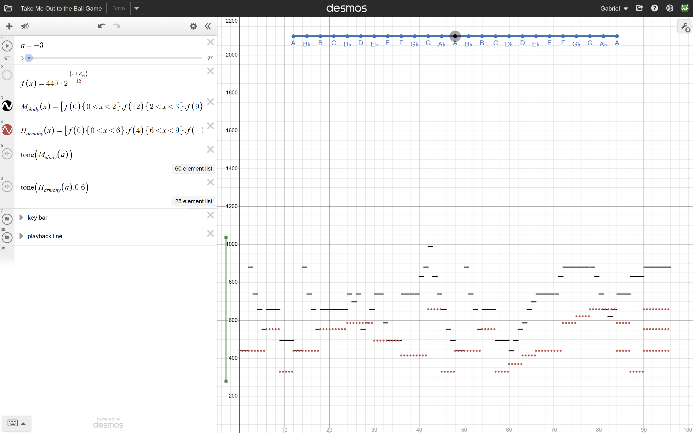
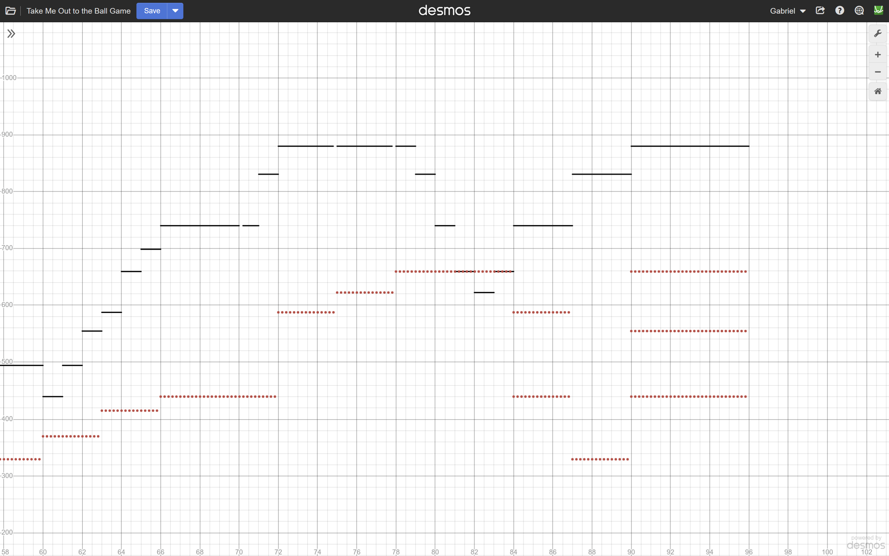
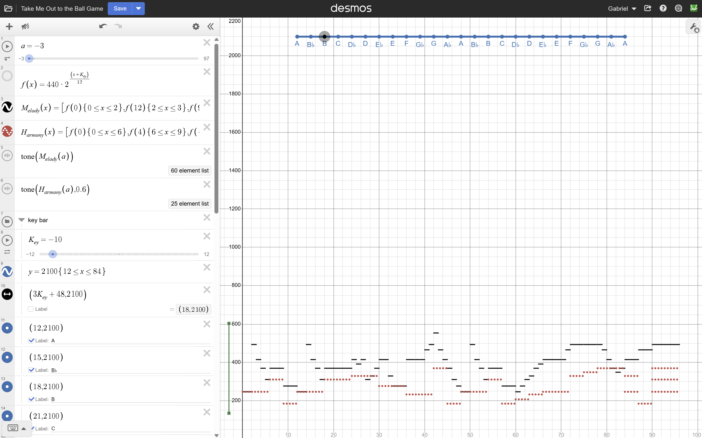
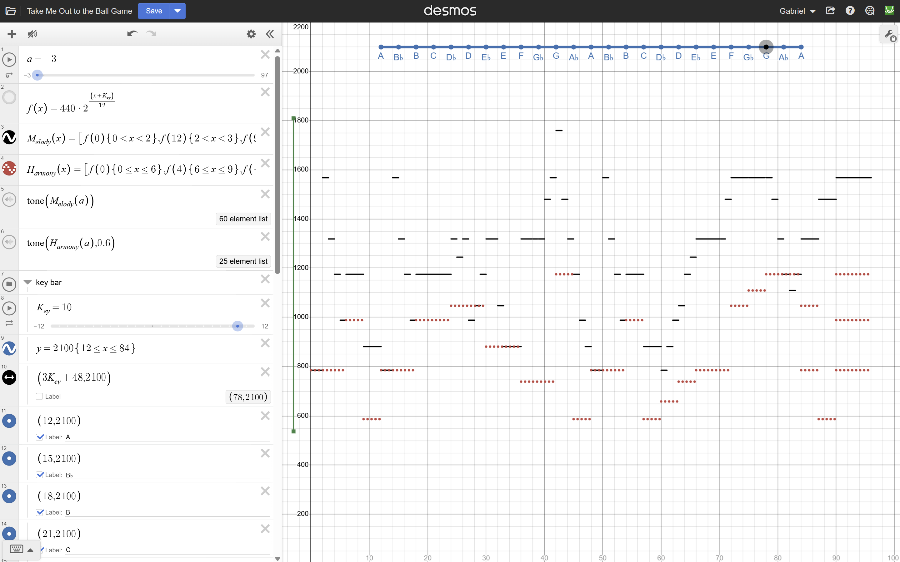
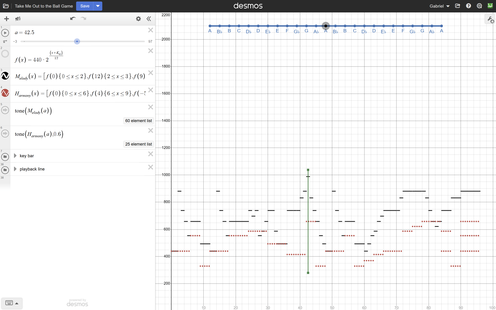

# Take Me Out to the Ball Game — Mathematical Music Player

An interactive Desmos project that uses exponential functions, domain restrictions, and the `tone()` operator to recreate the melody and harmony of *Take Me Out to the Ball Game*.

After discovering that Desmos could generate sound from mathematical expressions, I experimented with representing musical notes as frequencies and combining them into a complete composition.

I initially constructed the song in A, then expanded the project by creating an interactive key-transposition system. This allows the entire melody and harmony to shift between musical keys without changing their original note sequences or timing.

[**Explore the Interactive Graph in Desmos**](https://www.desmos.com/calculator/a7lmqu6y05)

## How It Works

The project represents music mathematically by assigning frequencies to notes and defining the intervals during which those frequencies are played.

The graph displays the melody in black and the harmony in dotted red. The horizontal axis represents progression through the composition, while the vertical axis represents frequency in hertz.

### Converting Musical Notes into Frequencies

The foundation of the project is a function based on the twelve-tone equal-tempered tuning system:

$$
f(x)=440\cdot2^{(x+K_{ey})/12}
$$

The constant 440 represents the frequency, in hertz, of A4. The variable $x$ represents a number of semitones relative to A4, while $K_{ey}$ provides an additional semitone adjustment for changing musical keys.

In equal temperament, moving up one semitone multiplies the frequency by $2^{1/12}$, while moving up twelve semitones doubles the frequency.

For example, when $K_{ey}=0$:

- $f(0)=440$ Hz, corresponding to A4.
- $f(4)\approx554.37$ Hz, corresponding to C-sharp 5.
- $f(7)\approx659.26$ Hz, corresponding to E5.
- $f(12)=880$ Hz, corresponding to A5.

Rather than manually assigning a separate frequency to every musical note, I used this exponential relationship to calculate frequencies from semitone intervals.

The same function is used throughout the entire composition, allowing the melody, harmony, and key-transposition system to share one mathematical foundation.

### Constructing the Melody

I represented the melody using a list of 60 domain-restricted expressions.

Each expression contains a frequency calculation and a restriction determining when that frequency should be active.

For example, the beginning of the melody includes:

$$
f(0)\lbrace 0\leq x\leq2\rbrace
$$

$$
f(12)\lbrace 2\leq x\leq3\rbrace
$$

$$
f(9)\lbrace 3\leq x\leq4\rbrace
$$

The first expression plays the frequency corresponding to $f(0)$ over the interval from 0 to 2. The second plays $f(12)$ from 2 to 3, and the third plays $f(9)$ from 3 to 4.

This structure allows each note to have its own pitch, starting position, and duration.

I also introduced small gaps between certain expressions to separate repeated notes. For example, three consecutive occurrences of $f(9)$ are assigned the intervals:

- $36\leq x\leq37.8$
- $38\leq x\leq38.8$
- $39\leq x\leq40$

The gaps distinguish the repeated notes rather than allowing them to sound as one uninterrupted tone.

By combining these restrictions into a single list, I encoded the melody as a mathematical sequence of frequencies distributed across a timeline.

### Constructing the Harmony

I created a separate list containing 25 domain-restricted expressions to represent the harmony.

The harmony follows the same frequency function as the melody, but its notes generally extend over longer intervals, providing accompaniment beneath the main tune.

For example, the beginning of the harmony includes:

$$
f(0)\lbrace 0\leq x\leq6\rbrace
$$

$$
f(4)\lbrace 6\leq x\leq9\rbrace
$$

$$
f(-5)\lbrace 9\leq x\leq12\rbrace
$$

Because the melody and harmony are stored in separate lists, both can be evaluated at the same position on the timeline and played simultaneously.

An additional feature is the use of overlapping intervals within the harmony itself.

Near the end of the composition, several harmony expressions are active at the same time. For example, during $90\leq x\leq96$, the harmony contains:

$$
f(0),\quad f(4),\quad f(7)
$$

In the original key, these correspond to A, C-sharp, and E, forming an A major chord.

This demonstrates how overlapping domain restrictions can produce several simultaneous frequencies instead of a single note.

The result is a composition in which mathematical expressions determine not only individual pitches and durations, but also the relationships between notes played together.

### Generating Sound and Controlling Playback

To convert the frequency expressions into sound, I used Desmos's `tone()` operator.

The melody is played using:

`tone(M_elody(a))`

The harmony is played using:

`tone(H_armony(a),0.6)`

The second argument in the harmony expression reduces its volume relative to the melody.

The variable $a$ acts as a playback-position parameter. As its value increases, Desmos evaluates the melody and harmony expressions at successive positions along the timeline.

I also constructed a green vertical playback indicator to show the currently selected position on the graph.

As the slider moves, the indicator travels across the visualized notes while the corresponding frequencies are passed to the `tone()` expressions.

This connects the visual representation of the composition with the sounds generated by the mathematical functions.

### Musical Key Transposition

After completing the original composition in A, I realized that the exponential frequency function could be modified to change the key of the entire song.

Instead of rewriting the melody and harmony expressions for different keys, I introduced the variable $K_{ey}$ into the exponent:

$$
f(x)=440\cdot2^{(x+K_{ey})/12}
$$

When $K_{ey}=0$, the composition plays in its original key of A.

Changing $K_{ey}$ by a value $k$ multiplies every frequency by the same factor:

$$
2^{k/12}
$$

Because both the melody and harmony use the same function, this adjustment changes every note simultaneously while preserving the intervals between notes.

For example, setting $K_{ey}=-10$ gives:

$$
f(x)=440\cdot2^{(x-10)/12}
$$

Every frequency is multiplied by $2^{-10/12}$, transposing the composition ten semitones downward from A to B.

Alternatively, setting $K_{ey}=10$ gives:

$$
f(x)=440\cdot2^{(x+10)/12}
$$

Every frequency is multiplied by $2^{10/12}$, transposing the composition ten semitones upward from A to G.

Although these adjustments change the absolute frequencies, the mathematical relationships between the notes remain unchanged.

For any two semitone inputs $x_1$ and $x_2$, their frequency ratio is:

$$
\frac{f(x_2)}{f(x_1)}=2^{(x_2-x_1)/12}
$$

The key-adjustment variable cancels from this ratio, showing mathematically why the intervals between notes are preserved during transposition.

I also created a blue key-selection bar at the top of the graph, labeled with musical notes. Moving the selector changes $K_{ey}$ and allows the composition to be transposed interactively.

This was an extension of the original project: a single additional variable made it possible to transform the entire musical composition without modifying its 60 melody expressions or 25 harmony expressions individually.

## Full Mathematical Expressions

The complete melody and harmony are constructed from 85 domain-restricted expressions.

The expressions are included below in full to document the mathematical structure of the composition.

### Complete Melody

$$
M_{elody}(x)=[
f(0)\lbrace 0\leq x\leq2\rbrace,
f(12)\lbrace 2\leq x\leq3\rbrace,
f(9)\lbrace 3\leq x\leq4\rbrace,
f(7)\lbrace 4\leq x\leq5\rbrace,
f(4)\lbrace 5\leq x\leq6\rbrace,
f(7)\lbrace 6\leq x\leq9\rbrace,
f(2)\lbrace 9\leq x\leq12\rbrace,
f(0)\lbrace 12\leq x\leq14\rbrace,
f(12)\lbrace 14\leq x\leq15\rbrace,
f(9)\lbrace 15\leq x\leq16\rbrace,
f(7)\lbrace 16\leq x\leq17\rbrace,
f(4)\lbrace 17\leq x\leq18\rbrace,
f(7)\lbrace 18\leq x\leq24\rbrace,
f(9)\lbrace 24\leq x\leq25\rbrace,
f(8)\lbrace 25\leq x\leq26\rbrace,
f(9)\lbrace 26\leq x\leq27\rbrace,
f(4)\lbrace 27\leq x\leq28\rbrace,
f(5)\lbrace 28\leq x\leq29\rbrace,
f(7)\lbrace 29\leq x<30\rbrace,
f(9)\lbrace 30\leq x\leq32\rbrace,
f(5)\lbrace 32\leq x\leq33\rbrace,
f(2)\lbrace 33\leq x\leq36\rbrace,
f(9)\lbrace 36\leq x\leq37.8\rbrace,
f(9)\lbrace 38\leq x\leq38.8\rbrace,
f(9)\lbrace 39\leq x\leq40\rbrace,
f(11)\lbrace 40\leq x\leq41\rbrace,
f(12)\lbrace 41\leq x\leq42\rbrace,
f(14)\lbrace 42\leq x\leq43\rbrace,
f(11)\lbrace 43\leq x\leq44\rbrace,
f(9)\lbrace 44\leq x\leq45\rbrace,
f(7)\lbrace 45\leq x\leq46\rbrace,
f(4)\lbrace 46\leq x\leq47\rbrace,
f(2)\lbrace 47\leq x\leq48\rbrace,
f(0)\lbrace 48\leq x\leq50\rbrace,
f(12)\lbrace 50\leq x\leq51\rbrace,
f(9)\lbrace 51\leq x\leq52\rbrace,
f(7)\lbrace 52\leq x\leq53\rbrace,
f(4)\lbrace 53\leq x\leq54\rbrace,
f(7)\lbrace 54\leq x\leq57\rbrace,
f(2)\lbrace 57\leq x\leq60\rbrace,
f(0)\lbrace 60\leq x\leq61\rbrace,
f(2)\lbrace 61\leq x\leq62\rbrace,
f(4)\lbrace 62\leq x\leq63\rbrace,
f(5)\lbrace 63\leq x\leq64\rbrace,
f(7)\lbrace 64\leq x\leq65\rbrace,
f(8)\lbrace 65\leq x\leq66\rbrace,
f(9)\lbrace 66\leq x\leq70\rbrace,
f(9)\lbrace 70.2\leq x\leq71\rbrace,
f(11)\lbrace 71\leq x\leq72\rbrace,
f(12)\lbrace 72\leq x\leq74.8\rbrace,
f(12)\lbrace 75\leq x\leq77.8\rbrace,
f(12)\lbrace 78\leq x\leq79\rbrace,
f(11)\lbrace 79\leq x\leq80\rbrace,
f(9)\lbrace 80\leq x\leq81\rbrace,
f(7)\lbrace 81\leq x\leq82\rbrace,
f(6)\lbrace 82\leq x\leq83\rbrace,
f(7)\lbrace 83\leq x\leq84\rbrace,
f(9)\lbrace 84\leq x\leq87\rbrace,
f(11)\lbrace 87\leq x\leq90\rbrace,
f(12)\lbrace 90\leq x\leq96\rbrace
]
$$

### Complete Harmony

$$
H_{armony}(x)=[
f(0)\lbrace 0\leq x\leq6\rbrace,
f(4)\lbrace 6\leq x\leq9\rbrace,
f(-5)\lbrace 9\leq x\leq12\rbrace,
f(0)\lbrace 12\leq x\leq18\rbrace,
f(4)\lbrace 18\leq x\leq24\rbrace,
f(5)\lbrace 24\leq x\leq30\rbrace,
f(2)\lbrace 30\leq x\leq36\rbrace,
f(-1)\lbrace 36\leq x\leq42\rbrace,
f(7)\lbrace 42\leq x\leq45\rbrace,
f(-5)\lbrace 45\leq x\leq48\rbrace,
f(0)\lbrace 48\leq x\leq54\rbrace,
f(4)\lbrace 54\leq x\leq57\rbrace,
f(-5)\lbrace 57\leq x\leq60\rbrace,
f(-3)\lbrace 60\leq x\leq63\rbrace,
f(-1)\lbrace 63\leq x\leq66\rbrace,
f(0)\lbrace 66\leq x\leq72\rbrace,
f(5)\lbrace 72\leq x\leq75\rbrace,
f(6)\lbrace 75\leq x\leq78\rbrace,
f(7)\lbrace 78\leq x\leq84\rbrace,
f(5)\lbrace 84\leq x\leq87\rbrace,
f(7)\lbrace 90\leq x\leq96\rbrace,
f(4)\lbrace 90\leq x\leq96\rbrace,
f(0)\lbrace 84\leq x\leq87\rbrace,
f(-5)\lbrace 87\leq x\leq90\rbrace,
f(0)\lbrace 90\leq x\leq96\rbrace
]
$$

These expressions use Desmos lists rather than conventional single-valued piecewise functions. This allows multiple restricted expressions to remain active over the same interval, producing simultaneous notes and chords.

## Screenshots

### Musical Composition and Harmony

**1. Complete Composition in A**

The original composition displays the melody in black and harmony in dotted red. The expressions panel shows the shared exponential frequency function, the two note lists, and the `tone()` commands used to generate sound.

**2. Melody and Harmony Detail**

A closer view of the later portion of the composition shows the different note durations and the relationship between the melody and harmony. Multiple harmony frequencies appear simultaneously near the ending, demonstrating how overlapping restrictions produce chords.

### Musical Key Transposition

**3. Transposition to B**

Setting $K_{ey}=-10$ modifies the frequency function to:

$$
f(x)=440\cdot2^{(x-10)/12}
$$

This multiplies every note frequency by $2^{-10/12}$, transposing the composition ten semitones downward from A to B.

The melody and harmony move into a lower frequency range while retaining their original timing and relative musical intervals.

**4. Transposition to G**

Setting $K_{ey}=10$ modifies the frequency function to:

$$
f(x)=440\cdot2^{(x+10)/12}
$$

This multiplies every note frequency by $2^{10/12}$, transposing the composition ten semitones upward from A to G.

Unlike the previous example, the entire composition shifts into a higher frequency range. The same melody and harmony expressions remain unchanged, demonstrating how modifying one exponent can transpose the entire piece.

### Interactive Playback

**5. Playing the Composition**

The green playback indicator is positioned at $a=42.5$.

At this value, the melody and harmony lists are evaluated at the same position on the timeline, and the corresponding frequencies are supplied to the `tone()` operators.

As the playback slider moves through the composition, the active frequencies change according to the domain restrictions, allowing the graph to produce the musical sequence.

## Mathematical Concepts

This project combines exponential functions, equal-tempered musical tuning, domain restrictions, lists of conditional expressions, simultaneous function evaluation, frequency ratios, and parameter-based transformations.

The composition demonstrates how mathematical expressions can encode musical information, including pitch, timing, note duration, repeated notes, and harmony.

The key-transposition system extends this idea by showing how a single variable in an exponential function can transform an entire composition while preserving its internal frequency relationships.

By constructing the song through Desmos, I explored how mathematical functions can be used not only to visualize information, but also to generate sound and create an interactive musical experience.
