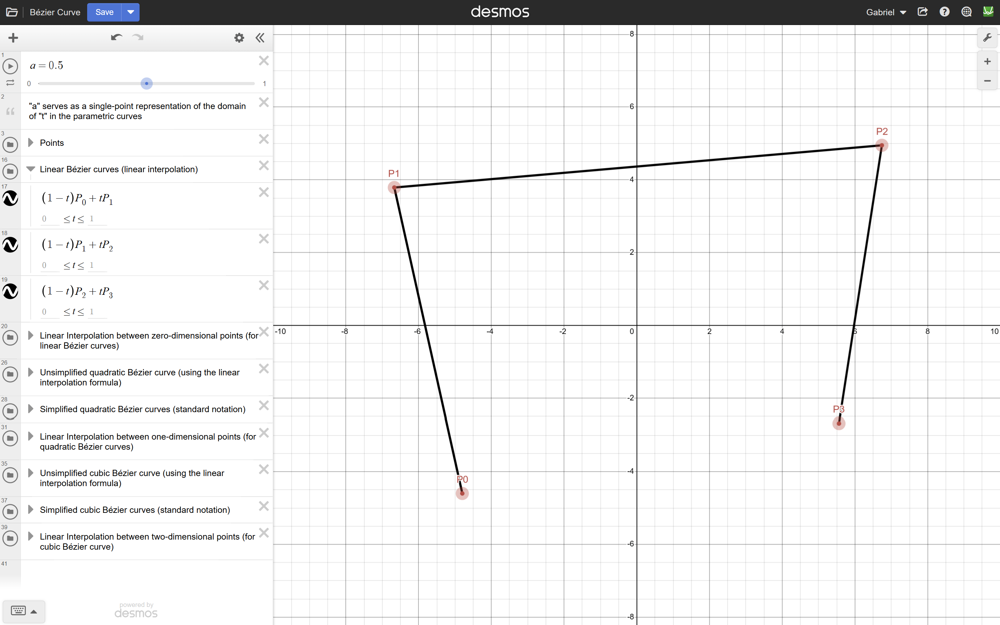
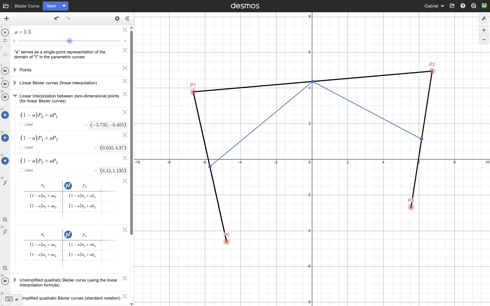
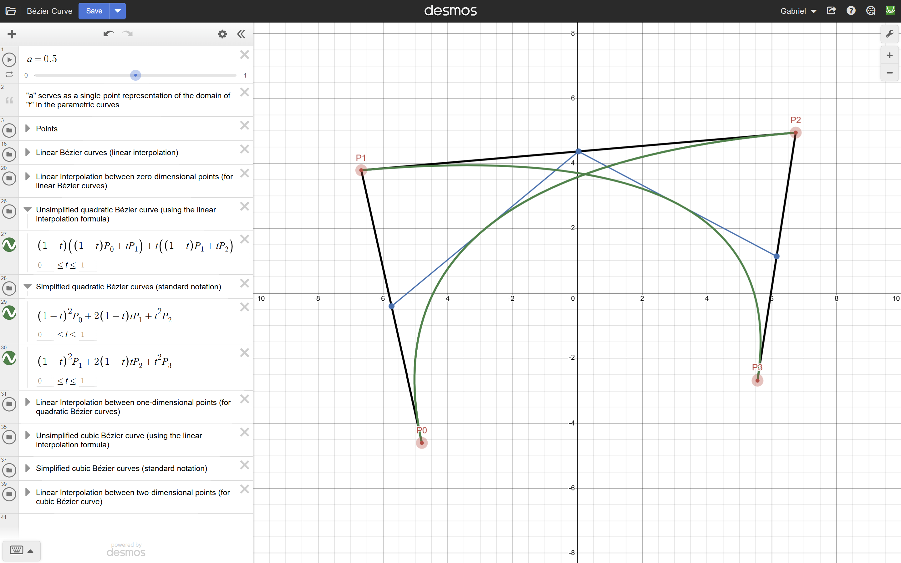
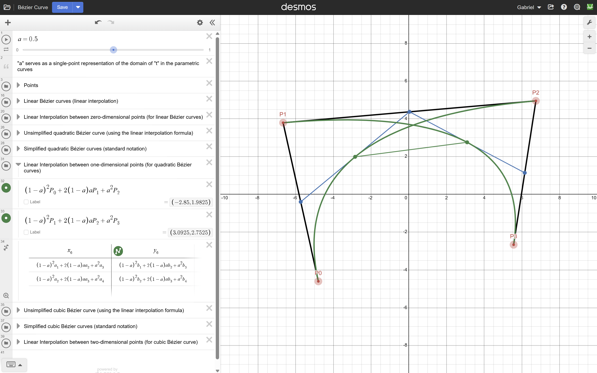
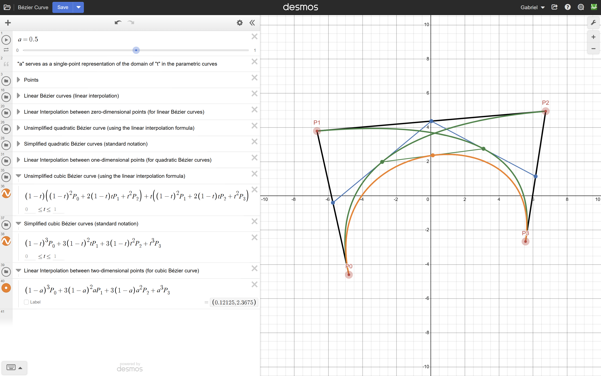
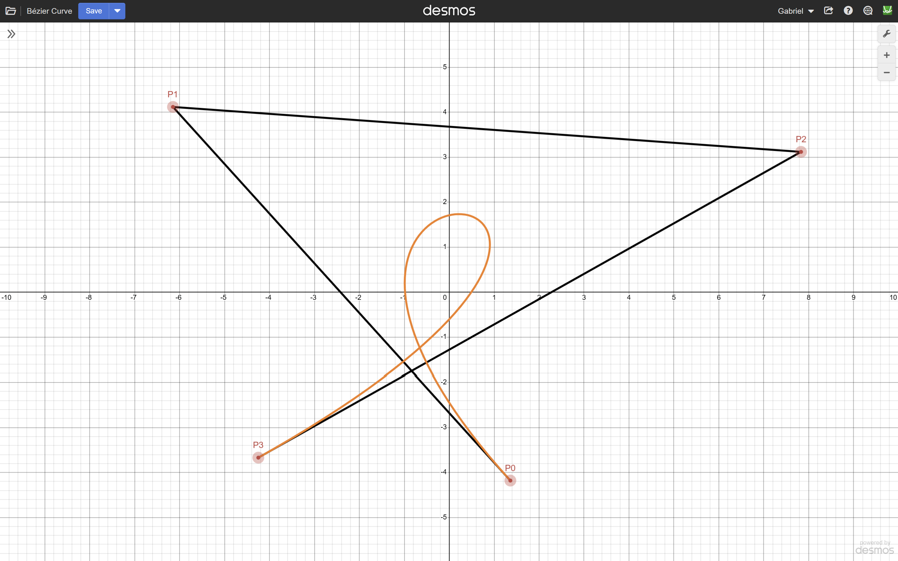
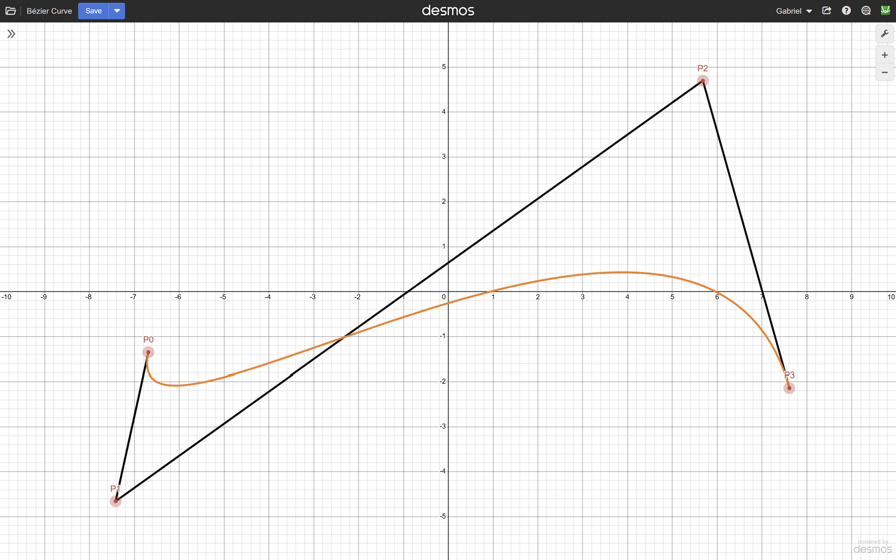
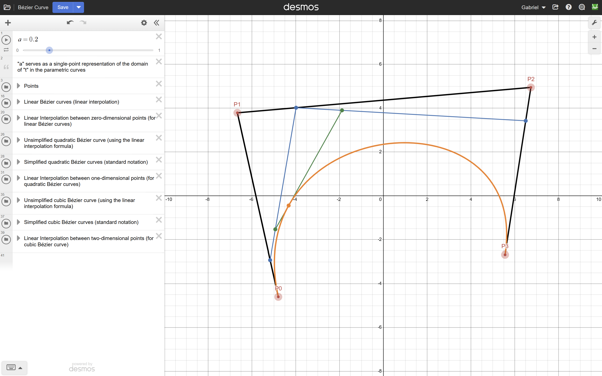
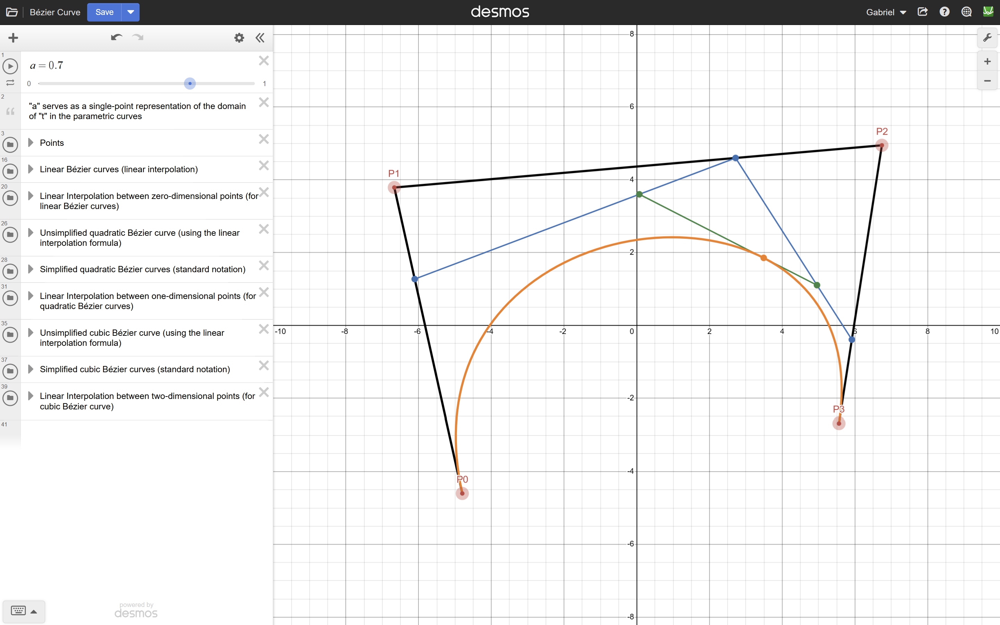

# Bézier Curve

For my AP Calculus BC final project, I chose to use Desmos to explore how Bézier curves can be constructed mathematically through repeated linear interpolation.

Beginning with four control points, I developed a series of linear, quadratic, and cubic Bézier curves, using equations and interactive points to visualize how increasingly complex curves emerge from a single interpolation formula.

This project demonstrates both the algebraic derivation of Bézier curves and their geometric behavior as the control points and interpolation parameter change.

[**Explore the Interactive Graph in Desmos**](https://www.desmos.com/calculator/ggu5m46gpj)

## How It Works

The project begins with four movable control points, $P_0$, $P_1$, $P_2$, and $P_3$, connected by straight line segments. These form a *control polygon* that influences the resulting Bézier curve.

I constructed the curve in stages, using linear interpolationat at each level.

### Linear Interpolation

Linear interpolation determines a point between two given points using a parameter $t$, where $0 \leq t \leq 1$.

For two points $P_0$ and $P_1$, the interpolation formula is:

$$
L(t)=(1-t)P_0+tP_1
$$

When $t=0$, the resulting point is $P_0$. When $t=1$, it is $P_1$. Intermediate values produce points along the line segment connecting them.

I applied this formula to each consecutive pair of control points:

$$
L_0(t)=(1-t)P_0+tP_1
$$

$$
L_1(t)=(1-t)P_1+tP_2
$$

$$
L_2(t)=(1-t)P_2+tP_3
$$

These three linear interpolations form the first stage of the construction.

In Desmos, the original control polygon is displayed in black, while blue points represent the positions generated by the interpolation formulas at a selected parameter value.

### Constructing Quadratic Bézier Curves

The next stage applies linear interpolation again, but instead of interpolating directly between the original control points, it interpolates between the results of the first stage.

For the first three control points, the unsimplified quadratic expression is:

$$
Q_0(t)=(1-t)L_0(t)+tL_1(t)
$$

Substituting the linear interpolation formulas gives:

$$
Q_0(t)=(1-t)((1-t)P_0+tP_1)+t((1-t)P_1+tP_2)
$$

Expanding and combining like terms produces the standard quadratic Bézier formula:

$$
Q_0(t)=(1-t)^2P_0+2(1-t)tP_1+t^2P_2
$$

The same process applied to the next three control points produces a second quadratic curve:

$$
Q_1(t)=(1-t)^2P_1+2(1-t)tP_2+t^2P_3
$$

These two quadratic curves are displayed in green.

I included both the nested interpolation expressions and their simplified polynomial forms in Desmos to demonstrate how the standard quadratic formula emerges from repeated linear interpolation.

The construction also evaluates individual points on both quadratic curves, allowing them to be connected by a line segment for the final stage.

### Constructing the Cubic Bézier Curve

The cubic Bézier curve is produced by applying linear interpolation once more, this time between the two quadratic curves.

The initial expression is:

$$
B(t)=(1-t)Q_0(t)+tQ_1(t)
$$

Substituting the quadratic equations produces:

$$
B(t)=(1-t)((1-t)^2P_0+2(1-t)tP_1+t^2P_2)+t((1-t)^2P_1+2(1-t)tP_2+t^2P_3)
$$

Expanding and simplifying gives the standard cubic Bézier equation:

$$
B(t)=(1-t)^3P_0+3(1-t)^2tP_1+3(1-t)t^2P_2+t^3P_3
$$

This is the final orange curve displayed in the graph.

The cubic formula is especially interesting because its coefficients and powers arise naturally from the repeated interpolation process. The coefficients $1,3,3,1$ follow the same pattern as the binomial expansion of $(a+b)^3$.

The four polynomial weights sum to 1:

$$
(1-t)^3+3(1-t)^2t+3(1-t)t^2+t^3=1
$$

For $0 \leq t \leq 1$, these weights are also nonnegative. Consequently, the cubic Bézier curve remains within the convex hull of its four control points.

This recursive construction is known as **de Casteljau's algorithm**, which provides a geometric way to evaluate Bézier curves through successive linear interpolations.

### Interactive Interpolation

To visualize how the construction works at individual points, I introduced a slider, $a$, ranging from 0 to 1.

The parameter $t$ describes the entire parametric curve, while $a$ selects a specific value at which the interpolation formulas are evaluated.

At a given value of $a$:

- **Blue points** represent the three linear interpolations between the original control points.
- **Green points** represent the two quadratic interpolations between the blue points.
- **The orange point** represents the final cubic interpolation between the green points.

As the slider moves, these intermediate points and their connecting segments move continuously through the construction.

The orange point traces the cubic Bézier curve, demonstrating how a point on the final curve is determined by multiple successive interpolations.

Importantly, changing $a$ does not change the shape of the complete curve. It changes only the positions of the intermediate construction points. The full curve is determined by the locations of the control points.

### Changing the Control Points

The four control points are movable, allowing the shape of the cubic Bézier curve to be modified interactively.

Although the curve always begins at $P_0$ and ends at $P_3$, the positions of $P_1$ and $P_2$ influence the path between these endpoints.

By experimenting with different control-point arrangements, I was able to produce substantially different curve shapes, including smooth bends and a loop.

This demonstrates how a single parametric equation can generate a wide variety of geometric forms simply by changing its control points.

## Screenshots

### Constructing the Cubic Bézier Curve

**1. Control Points and Linear Bézier Curves**

The original four control points, connected by the black control polygon. The linear interpolation formulas form the starting point for the entire construction.

**2. First Stage of Linear Interpolation**

Three blue points are generated by interpolating between consecutive control points. These intermediate points provide the inputs for the quadratic stage.

**3. Quadratic Bézier Curves**

Two green quadratic Bézier curves are constructed from the first stage of interpolation. The expressions panel shows how a nested interpolation formula can be expanded into the standard quadratic form.

**4. Interpolation Between Quadratic Curves**

Two individual points are evaluated on the quadratic Bézier curves at the same parameter value. The line segment connecting them represents the final interpolation step needed to construct the cubic curve.

**5. Final Cubic Bézier Curve**

The orange cubic curve is constructed from the preceding interpolation stages. The expressions panel displays the unsimplified and simplified cubic formulas, illustrating how the final polynomial emerges from repeated linear interpolation.

### Exploring Different Control Point Positions

**6. Loop-Shaped Cubic Bézier Curve**

Rearranging the control points produces a loop-shaped cubic curve, demonstrating how the same equation can generate a self-intersecting path.

**7. Alternate Cubic Bézier Curve**

A different arrangement of the control points produces another curve shape, illustrating the flexibility of the cubic Bézier equation.

### Interpolation at Different Parameter Values

**8. Interpolation at $a=0.2$**

The construction is evaluated at an early parameter value. The blue, green, and orange points show the successive interpolation stages, with the final orange point positioned closer to the beginning of the cubic curve.

**9. Interpolation at $a=0.7$**

The same construction is evaluated at a later parameter value. The intermediate points have moved, placing the final orange point farther along the cubic curve, while the underlying curve remains unchanged.

## Mathematical Concepts

This project combines linear interpolation, parametric equations, quadratic and cubic polynomials, polynomial expansion, recursive mathematical construction, and geometric transformations.

The construction illustrates how repeated applications of a relatively simple equation can produce increasingly complex mathematical behavior. By developing both the nested interpolation expressions and their simplified polynomial forms, I explored the connection between the geometric construction of Bézier curves and their algebraic representations.

Using Desmos allowed me to make this relationship interactive, connecting the movement of individual points with the equations defining entire curves.
