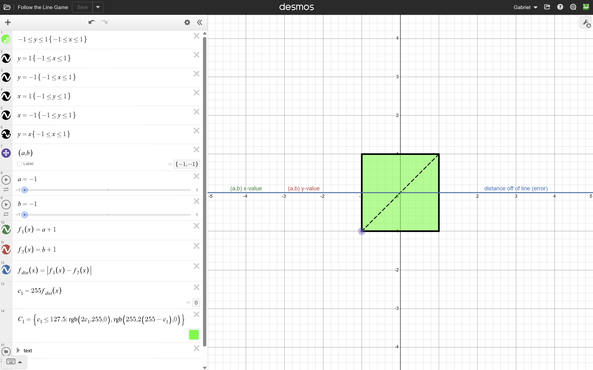
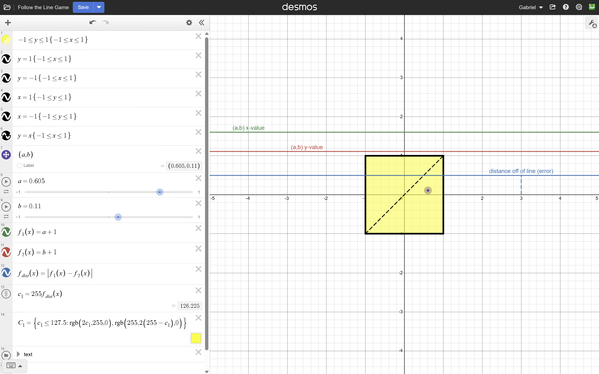
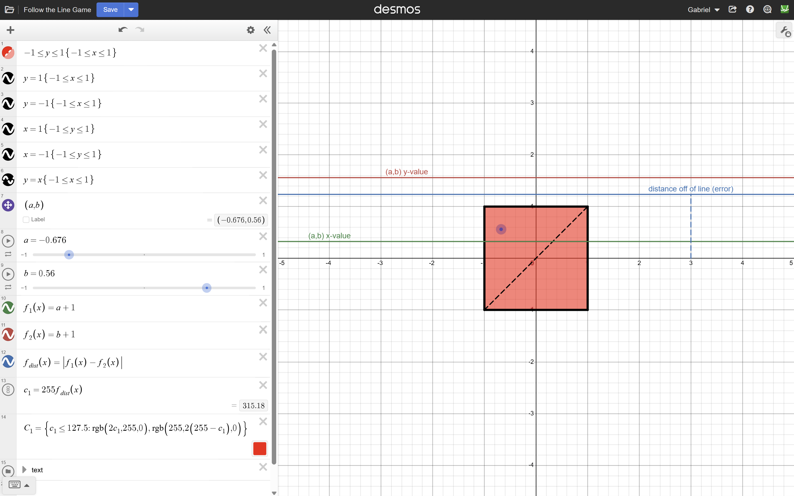

# Follow the Line Game

An interactive Desmos project where the goal is to move a draggable point as close as possible to the line $y=x$.

The square changes color based on the point's distance from the line, giving immediate visual feedback.

[**Explore the Interactive Graph in Desmos**](PASTE_YOUR_DESMOS_LINK_HERE)

## How It Works

The game centers on a draggable point, $(a,b)$, inside a square bounded by $-1 \leq x \leq 1$ and $-1 \leq y \leq 1$. The objective is to position the point on the diagonal line $y=x$.

I designed a system that measures how closely the point follows this line and translates that measurement into visual feedback.

Two functions track the point's coordinates:

- $f_1=a+1$ represents the x-coordinate.
- $f_2=b+1$ represents the y-coordinate.

Adding 1 shifts both values into the interval $[0,2]$, providing a common zero baseline for the visual indicators.

The error is calculated using the absolute difference:

$$
E=|f_1-f_2|=|a-b|
$$

When $a=b$, the error is zero, meaning the point lies exactly on $y=x$. As the coordinates diverge, the error increases. This measurement is proportional to the point's perpendicular distance from the line.

The graph displays the two coordinate values using green and red indicator lines, while a blue indicator represents the error. A piecewise RGB color function uses that error to continuously change the square's color:

- **Green:** The point lies on or very close to the target line.
- **Yellow:** The point has a moderate error.
- **Red:** The point is farther from the line.

## Screenshots

### On the Line

### Moderate Error

### Large Error

## Mathematical Concepts

This project combines coordinate geometry, absolute value, domain restrictions, functions, and piecewise color transformations.

It illustrates how a simple mathematical relationship can be used to create an interactive system: equations determine the behavior, and visual feedback makes the underlying mathematics immediately observable.
