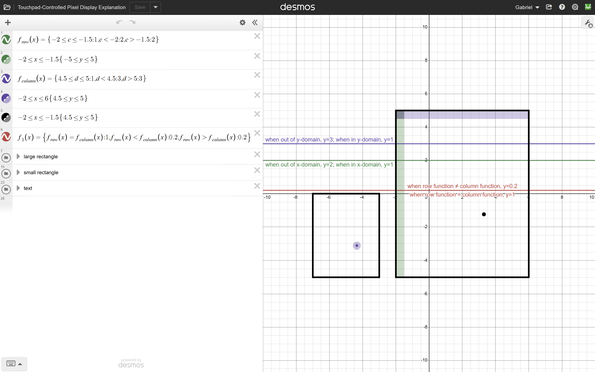
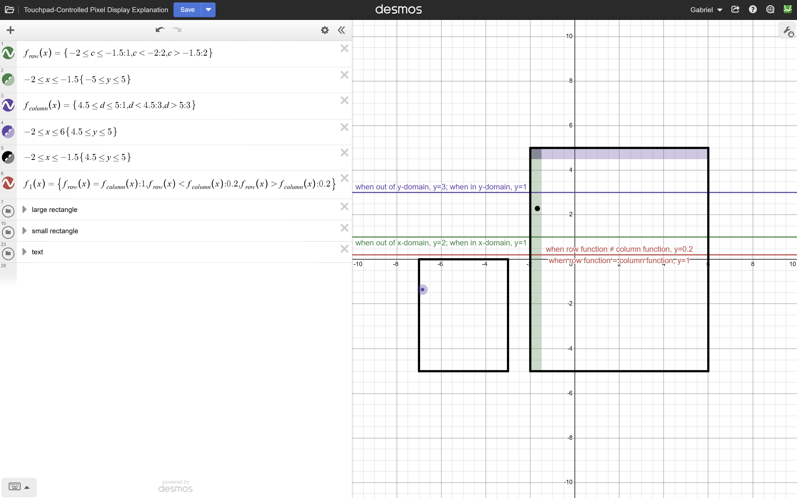
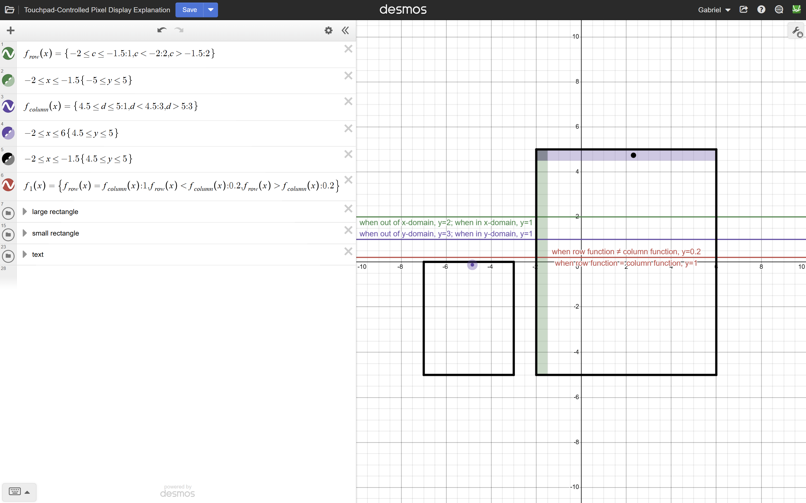
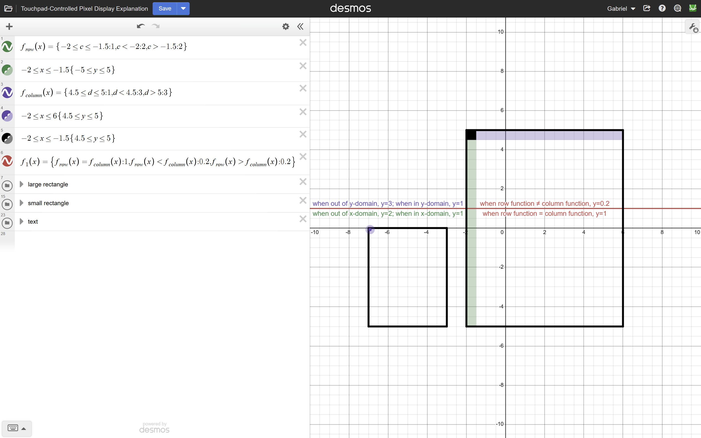
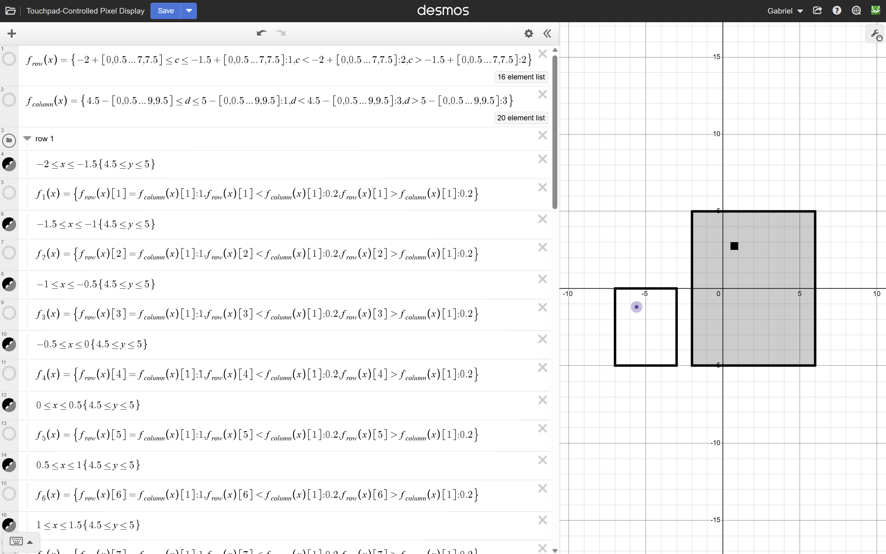

# Touchpad-Controlled Pixel Display

An interactive Desmos project that uses piecewise functions, inequalities, conditional logic, and list indexing to create a 320-pixel display controlled by a smaller touchpad.

I began this project as an independent challenge to explore how far I could push Desmos's mathematical capabilities, particularly its support for lists. My initial goal was to make a draggable point inside a small rectangle control a corresponding position in a larger rectangle.

The project developed into two connected mathematical challenges: creating a system that activates an individual pixel only when two separate conditions are satisfied, and then expanding that system across a 16-by-20 grid while minimizing repetitive mathematical expressions.

The completed display contains 320 individually controlled pixel regions, all governed by the same underlying conditional logic.

[**Explore the Completed Pixel Display in Desmos**](https://www.desmos.com/calculator/jqsijg4zbj)

[**Explore the Single-Pixel Explanation in Desmos**](https://www.desmos.com/calculator/p1wxaqyzvm)

## Part One: Developing the Conditional Logic

### The Original Problem

The first challenge was determining how to make an individual pixel respond to the position of a draggable point.

The project consists of two rectangular regions:

- **The smaller rectangle:** Functions as a touchpad containing a draggable point.
- **The larger rectangle:** Functions as a display, with positions corresponding to those in the smaller rectangle.

The larger rectangle has twice the width and height of the smaller rectangle. The point's coordinates are transformed so that moving it inside the touchpad corresponds to moving a position around the enlarged display.

I wanted to divide the larger rectangle into small square pixels and make a pixel become fully visible only when the corresponding point was inside that pixel's boundaries.

This required checking two conditions simultaneously:

1. Whether the point's horizontal coordinate falls within the pixel's horizontal interval.
2. Whether the point's vertical coordinate falls within the pixel's vertical interval.

Neither condition is sufficient by itself. Both must be satisfied for the pixel to activate.

To explore this problem, I developed a mathematical system that converts these conditions into numerical values and compares them.

### Representing Conditions Numerically

I created two piecewise functions, `f_row` and `f_column`, to evaluate the point's position.

In the simplified explanation graph, the selected pixel is the square bounded by:

$$
-2\leq x\leq-1.5
$$

$$
4.5\leq y\leq5
$$

The variables $c$ and $d$ represent the corresponding horizontal and vertical coordinates being tested.

The first function evaluates the horizontal condition:

$$
f_{row}(x)=\lbrace -2\leq c\leq-1.5:1,\ c<-2:2,\ c>-1.5:2\rbrace
$$

This produces:

- **1** when the horizontal coordinate is inside the required interval.
- **2** when the horizontal coordinate is outside the interval.

The second function evaluates the vertical condition:

$$
f_{column}(x)=\lbrace4.5\leq d\leq5:1,\ d<4.5:3,\ d>5:3\rbrace
$$

This produces:

- **1** when the vertical coordinate is inside the required interval.
- **3** when the vertical coordinate is outside the interval.

The choice of numerical outputs was deliberate.

Both functions return 1 when their respective conditions are satisfied. However, their outputs when the conditions are false are different: 2 for the horizontal condition and 3 for the vertical condition.

This creates a useful mathematical property:

**The two functions can be equal only when both conditions are satisfied.**

### Combining Conditions Through Equality

Instead of directly checking two inequalities inside the final pixel function, I realized that I could compare the outputs of `f_row` and `f_column`.

The possible outcomes are:

| Horizontal Condition | Vertical Condition | `f_row` | `f_column` | Equal? |
|---|---|---|---|---|
| False | False | 2 | 3 | No |
| True | False | 1 | 3 | No |
| False | True | 2 | 1 | No |
| True | True | 1 | 1 | Yes |

Because the false outputs are unequal, the equality

$$
f_{row}(x)=f_{column}(x)
$$

holds only when both conditions are true.

This effectively reproduces the behavior of a logical **AND** operation using mathematical functions and numerical comparisons.

I found this particularly interesting because it allowed me to represent logical states using ordinary mathematical values, without relying on a separate Boolean data type.

### Controlling the Pixel's Fill Opacity

After establishing the conditional system, I connected its result to the visual appearance of an individual pixel.

Each pixel is constructed from inequalities defining a small rectangular region.

The corresponding fill function determines whether that region appears dim or fully opaque.

For the pixel in the explanation graph, I used:

$$
f_1(x)=\lbrace f_{row}(x)=f_{column}(x):1,\ f_{row}(x)<f_{column}(x):0.2,\ f_{row}(x)>f_{column}(x):0.2\rbrace
$$

The function returns one of two opacity values:

- **1:** The pixel is fully opaque because both conditions are satisfied.
- **0.2:** The pixel remains partially transparent because at least one condition is not satisfied.

By assigning this function to the pixel's fill opacity, the outcome of the mathematical comparison directly determines its visual appearance.

The pixel changes from gray to black when the point enters its corresponding region.

### Visualizing the Four Possible Outcomes

To make the conditional system easier to understand, I created a separate Desmos explanation graph that isolates a single pixel.

I originally developed this version to demonstrate the underlying mathematics to teachers and friends.

In the explanation graph, I added two translucent colored regions:

- **Green:** The horizontal interval in which `f_row` returns 1.
- **Purple:** The vertical interval in which `f_column` returns 1.

The overlap between these regions represents the set of points where both conditions are simultaneously satisfied.

The following four screenshots demonstrate every possible combination.

#### 1. Neither Condition Satisfied

The point is outside both the green and purple regions.

The horizontal function returns 2, while the vertical function returns 3:

$$
f_{row}(x)=2,\qquad f_{column}(x)=3
$$

Because the outputs differ, the pixel's opacity remains 0.2.

#### 2. Horizontal Condition Only

The point is inside the green region but outside the purple region.

The horizontal condition is satisfied, but the vertical condition is not:

$$
f_{row}(x)=1,\qquad f_{column}(x)=3
$$

Since the functions are unequal, the pixel remains inactive.

This demonstrates why satisfying only one condition is insufficient.

#### 3. Vertical Condition Only

The point is inside the purple region but outside the green region.

This time, the vertical condition is satisfied while the horizontal condition is not:

$$
f_{row}(x)=2,\qquad f_{column}(x)=1
$$

The outputs are still unequal, so the pixel's opacity remains 0.2.

#### 4. Both Conditions Satisfied

The point is located inside the intersection of the green and purple regions.

Both functions now return 1:

$$
f_{row}(x)=f_{column}(x)=1
$$

Because the outputs are equal, the pixel's opacity changes from 0.2 to 1.

The pixel becomes fully opaque, appearing black.

### The Mathematical Result

The four cases demonstrate that the pixel activates precisely when both positional conditions are satisfied.

The underlying relationship can be summarized as:

$$
f_{pixel}=\lbrace f_{row}=f_{column}:1,\ f_{row}\neq f_{column}:0.2\rbrace
$$

The green and purple regions provide a geometric interpretation of the same logical operation.

Their intersection represents a logical AND: membership in both sets is required to activate the pixel.

Once I had a functioning mathematical rule for controlling one pixel, the next challenge was extending that rule to an entire display.

---

## Part Two: Expanding the System Using Lists

### The Challenge of Scaling Up

After developing the conditional system for a single pixel, I wanted to apply it to a much larger grid.

The completed display contains 16 columns and 20 rows:

$$
16\times20=320
$$

Each pixel occupies a square measuring 0.5 units by 0.5 units.

The larger display spans:

$$
-2\leq x\leq6
$$

$$
-5\leq y\leq5
$$

A straightforward approach would involve defining a separate set of horizontal and vertical boundary conditions for every pixel.

However, this would require extensive repetition.

I wanted to find a way to reuse the same mathematical structure while allowing each pixel to respond to a different coordinate interval.

This is where Desmos's list functionality became central to the project.

### The Completed Display

The full project uses two list-based functions to evaluate positions across the display and individual indexed expressions to control each pixel's opacity.

The screenshot below shows the completed 320-pixel display, the smaller touchpad, and the mathematical expressions used to organize the system.

The left side displays the two list-generating functions and representative pixel equations from the first row.

The right side shows the visual result: a single illuminated pixel corresponding to the position of the draggable point.

### Generating Coordinate Intervals with Lists

Instead of manually defining every coordinate boundary independently, I used arithmetic sequences inside Desmos lists.

For the horizontal positions, the sequence is:

$$
[0,0.5,\ldots,7,7.5]
$$

This produces 16 elements, beginning at 0 and increasing by 0.5.

For the vertical positions, the sequence is:

$$
[0,0.5,\ldots,9,9.5]
$$

This produces 20 elements, also increasing by 0.5.

These sequences correspond to the grid's 16 horizontal positions and 20 vertical positions.

The horizontal sequence shifts an initial interval across the display.

Starting with:

$$
-2\leq c\leq-1.5
$$

adding successive list values generates intervals such as:

$$
-1.5\leq c\leq-1
$$

$$
-1\leq c\leq-0.5
$$

The final interval is:

$$
5.5\leq c\leq6
$$

Similarly, subtracting the vertical list values from an initial interval generates the vertical divisions of the grid.

Beginning with:

$$
4.5\leq d\leq5
$$

the sequence continues downward through intervals such as:

$$
4\leq d\leq4.5
$$

$$
3.5\leq d\leq4
$$

until the final interval:

$$
-5\leq d\leq-4.5
$$

This approach allowed me to generate entire collections of coordinate conditions using arithmetic sequences rather than separately writing every interval.

### List-Based Conditional Functions

I incorporated these sequences into the same conditional functions developed in Part One.

The full horizontal function uses the 16-element sequence:

$$
f_{row}(x)=\lbrace -2+[0,0.5,\ldots,7.5]\leq c\leq-1.5+[0,0.5,\ldots,7.5]:1,\ c<-2+[0,0.5,\ldots,7.5]:2,\ c>-1.5+[0,0.5,\ldots,7.5]:2\rbrace
$$

The full vertical function uses the 20-element sequence:

$$
f_{column}(x)=\lbrace4.5-[0,0.5,\ldots,9.5]\leq d\leq5-[0,0.5,\ldots,9.5]:1,\ d<4.5-[0,0.5,\ldots,9.5]:3,\ d>5-[0,0.5,\ldots,9.5]:3\rbrace
$$

These are extensions of the original single-pixel conditional functions.

Rather than evaluating one interval, each function evaluates multiple intervals and produces a corresponding list of numerical results.

For each horizontal interval, `f_row` returns either 1 or 2.

For each vertical interval, `f_column` returns either 1 or 3.

The important feature is that **the same conditional logic is evaluated across an entire collection of coordinate intervals**.

This eliminated the need to define separate coordinate-testing functions for every individual pixel.

### Selecting Conditions Through List Indexing

After generating the lists, I needed a way for each pixel to access the specific horizontal and vertical results corresponding to its position.

I accomplished this using Desmos's list-indexing notation.

For example:

$$
f_{row}(x)[1]
$$

selects the first entry of the horizontal-condition list, while:

$$
f_{column}(x)[1]
$$

selects the first entry of the vertical-condition list.

The square brackets are important: `[1]`, `[2]`, and so on select elements from a list rather than multiplying the function's result.

Across the completed display, I used:

- `f_row(x)[1]` through `f_row(x)[16]` for the 16 horizontal positions.
- `f_column(x)[1]` through `f_column(x)[20]` for the 20 vertical positions.

Each pixel receives the appropriate pair of indexed outputs based on its location in the grid.

For a pixel identified by horizontal index $i$ and vertical index $j$, the comparison becomes:

$$
f_{row}(x)[i]=f_{column}(x)[j]
$$

The pixel activates only when both indexed values equal 1.

This applies the same logical AND mechanism from the explanation graph to any position in the larger display.

### Applying the Logic to All 320 Pixels

I organized the completed display into 20 Desmos folders, one for each row.

Each folder contains 16 pixel regions and their corresponding opacity functions.

The pixels are constructed using inequalities that define 0.5-by-0.5 squares.

For example, the first pixel occupies:

$$
-2\leq x\leq-1.5\lbrace4.5\leq y\leq5\rbrace
$$

Its opacity is determined by comparing the first entries of the two condition lists:

$$
f_1(x)=\lbrace f_{row}(x)[1]=f_{column}(x)[1]:1,\ f_{row}(x)[1]<f_{column}(x)[1]:0.2,\ f_{row}(x)[1]>f_{column}(x)[1]:0.2\rbrace
$$

The next pixel uses the second horizontal entry while retaining the first vertical entry:

$$
f_2(x)=\lbrace f_{row}(x)[2]=f_{column}(x)[1]:1,\ f_{row}(x)[2]<f_{column}(x)[1]:0.2,\ f_{row}(x)[2]>f_{column}(x)[1]:0.2\rbrace
$$

This pattern continues across all 16 pixels in the first row.

For the second row, the horizontal indices begin again at 1, while the vertical index changes to 2.

The same structure repeats for every row, eventually reaching the final row, which uses the twentieth entry of `f_column`.

For example, pixel 305, the first pixel in the twentieth row, compares:

$$
f_{row}(x)[1]=f_{column}(x)[20]
$$

The remaining pixels in that row use successive horizontal indices through `[16]`.

The structure of the opacity calculation stays the same throughout the display. Only the indices change.

### Mathematical Organization and Optimization

The list-based system was the main organizational challenge of the project.

Without lists, I would have needed to repeatedly specify horizontal and vertical interval conditions within separate expressions for individual pixels.

Instead, I separated the problem into two components:

1. **Shared coordinate detection:** The two list-based functions evaluate the horizontal and vertical intervals.
2. **Individual pixel activation:** Each pixel retrieves the relevant list entries and compares their outputs to determine its opacity.

This did not eliminate the need to construct the 320 pixel regions or assign them their individual opacity functions.

However, it significantly reduced the amount of repeated conditional logic needed within those functions.

The approach also made the mathematical structure more consistent: every pixel uses the same rule, with its position determined through list indexing.

I found this especially satisfying because the problem shifted from figuring out how to activate one pixel to figuring out how to organize the same mathematical process across hundreds of pixels.

### Connecting the Two Parts

The completed project relies on the combination of the two ideas developed throughout this README.

**Conditional logic** determines whether an individual pixel should be active.

**List indexing** makes it possible to apply that logic systematically across the display.

For a pixel at horizontal index $i$ and vertical index $j$, the underlying opacity rule can be summarized as:

$$
P_{i,j}=\lbrace f_{row}(x)[i]=f_{column}(x)[j]:1,\ f_{row}(x)[i]\neq f_{column}(x)[j]:0.2\rbrace
$$

This one relationship summarizes the behavior of the full display.

A draggable point determines the position being evaluated. The two lists identify the corresponding horizontal and vertical intervals. Their indexed outputs determine which pixel becomes fully opaque.

The resulting system allows a relatively small input region to control the visual behavior of a much larger collection of mathematical objects.

## Mathematical Concepts

This project combines coordinate transformations, inequalities, domain and range restrictions, piecewise functions, arithmetic sequences, lists, list indexing, conditional logic, and dynamic visual properties.

The first part explores how numerical outputs can represent logical states. By deliberately choosing different false values, I created a system in which equality acts as a logical AND condition.

The second part explores how a mathematical mechanism can be generalized and organized efficiently. Arithmetic sequences and indexed lists allow the same coordinate-testing functions to be reused across hundreds of pixels.

What began as a challenge to explore Desmos's list functionality became an investigation into how mathematical expressions can reproduce behavior typically associated with programming: condition checking, organized data structures, and interactive visual output.

The completed 320-pixel display demonstrates how relatively simple mathematical rules, when combined and systematically organized, can produce a much larger interactive system.
